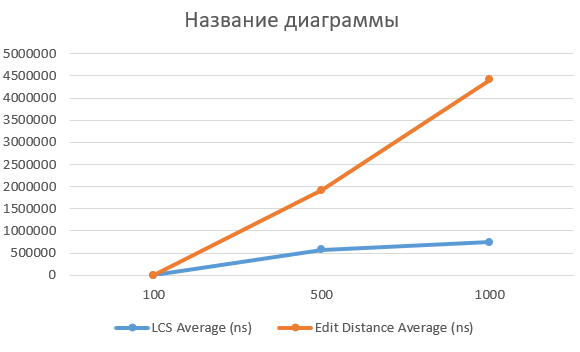
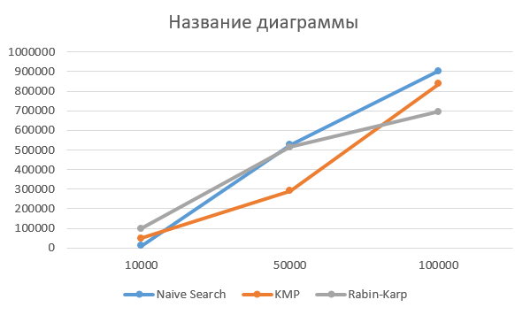
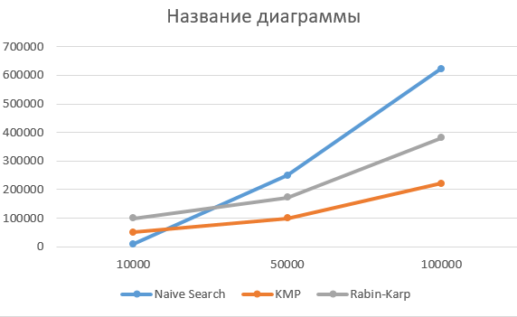
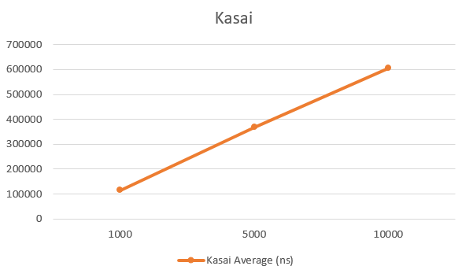

Assignment 4: text analysis - dynamic programming and string algorithms

1. Introduction

In this assignment, I implemented six algorithms related to dynamic programming and string processing.

The main goal was to understand how these algorithms work, test them, and compare their performance with different input sizes.

The implemented algorithms are:

1. Longest Common Subsequence (LCS)
2. Edit Distance
3. Naive Search
4. Knuth-Morris-Pratt (KMP)
5. Rabin-Karp
6. Kasai's Algorithm

I used Java to write the algorithms and JUnit 5 to test them.

2. Implemented Algorithms

2.1. Longest common subsequence (LCS)

LCS finds the longest subsequence that appears in two strings. The characters must be in the same order, but they do not have to be next to each other.

The algorithm uses dynamic programming and stores intermediate results in a table.

- Time complexity: O(n × m)
- Space complexity: O(n × m)

2.2. Edit Distance

Edit Distance finds the minimum number of operations needed to change one string into another.

There are three possible operations:

- Insert a character
- Delete a character
- Replace a character

The algorithm also uses dynamic programming.

- Time complexity: O(n × m)
- Space complexity: O(n × m)

2.3. Naive Search

Naive Search looks for a pattern inside a text. It checks the pattern at every possible position until it finds all matches.

It is easy to understand and implement, but it can be slow for large inputs.

- Best-case time complexity: O(n)
- Worst-case time complexity: O(n × m)
- Auxiliary space complexity: O(1), excluding the result list.

2.4. Knuth-Morris-Pratt (KMP)

KMP is a string searching algorithm. It uses an LPS array to avoid checking the same characters again after a mismatch.

This makes the algorithm more efficient than Naive Search in many cases.

- Time complexity: O(n + m)
- Space complexity: O(m)

2.5. Rabin-Karp

Rabin-Karp uses hash values to find a pattern in a text.

First, it calculates the hash of the pattern. Then it compares this value with the hash of each text window. If the hashes match, it checks the actual characters to make sure the pattern is found.

- Average expected time complexity: O(n + m)
- Worst-case time complexity: O(n × m)
- Auxiliary space complexity: O(1), excluding the result list.

2.6. Kasai's algorithm

Kasai's algorithm builds an LCP array using a text and its suffix array.

LCP means Longest Common Prefix. The array stores the lengths of common prefixes between neighboring suffixes in suffix array order.

- Time complexity: O(n)
- Space complexity: O(n)

The suffix array is created separately, so its construction time is not included in the Kasai experiment.

3. Time and space complexity

The following table shows the theoretical complexity of all implemented algorithms.

| Algorithm | Time Complexity | Space Complexity |
|---|---|---|
| LCS | O(n × m) | O(n × m) |
| Edit Distance | O(n × m) | O(n × m) |
| Naive Search | O(n × m) worst case | O(1) auxiliary |
| KMP | O(n + m) | O(m) |
| Rabin-Karp | O(n + m) expected | O(1) auxiliary |
| Kasai | O(n) | O(n) |

Here, n is the text or first string length, and m is the pattern or second string length, depending on the algorithm.

4. Unit Testing

I used JUnit 5 to check whether the algorithms work correctly.

The following test classes were created:

- `LCSTest`
- `EditDistanceTest`
- `StringMatchingTest`
- `KasaiTest`

The tests cover different situations, such as empty strings, normal inputs, patterns that exist in the text, patterns that are absent, and LCP array construction.

Test results

| Test Class | Passed Tests |
|---|---:|
| LCSTest | 3 |
| EditDistanceTest | 5 |
| StringMatchingTest | 7 |
| KasaiTest | 2 |
| **Total** | **17** |

All 17 tests passed successfully. There were no failures or errors.

5. Experimental Setup

I performed experiments to compare the execution time of the algorithms.

The experiment settings were:

- Programming language: Java
- Testing framework: JUnit 5
- Warm-up runs: 3
- Measurement trials: 5
- Time unit: nanoseconds (ns)
- Input alphabet: A, B, C, D

Different input sizes were used for different algorithms.

| Algorithm | Input Sizes |
|---|---|
| LCS | 100, 500, 1000 |
| Edit Distance | 100, 500, 1000 |
| Naive Search | 10,000, 50,000, 100,000 |
| KMP | 10,000, 50,000, 100,000 |
| Rabin-Karp | 10,000, 50,000, 100,000 |
| Kasai | 1,000, 5,000, 10,000 |

For string matching algorithms, I tested two cases:

- Present: the pattern exists in the text.
- Absent: the pattern does not exist in the text.

Each experiment was repeated five times, and the average execution time was calculated.

The raw results are saved in `results/experiment_results.csv`.

6. Experimental Results and Analysis

6.1. LCS vs Edit Distance

The table shows the average execution time of LCS and Edit Distance.

| Input Size (N) | LCS Average (ns) | Edit Distance Average (ns) |
|---:|-----------------:|---------------------------:|
| 100 |           579000 |                     745380 |
| 500 |          1345120 |                    3671720 |
| 1,000 |          5799500 |                    6842800 |

**Analysis:**

As the input size increases, both algorithms take more time to finish.

In my experiment, LCS was faster than Edit Distance for all tested input sizes. Both algorithms have O(n × m) time complexity because they use dynamic programming.

The difference in execution time can be related to the number of operations and implementation details.

6.2. String Matching - Present Pattern

In this experiment, I compared Naive Search, KMP, and Rabin-Karp when the pattern exists in the text.

| Input Size (N) | Naive Search (ns) | KMP (ns) | Rabin-Karp (ns) |
|---:|------------------:|---------:|----------------:|
| 10,000 |            525920 |   904100 |          758940 |
| 50,000 |            291820 |   836860 |          490180 |
| 100,000 |            515040 |   694520 |          402380 |

**Analysis:**

For the smallest input size, Naive Search was the fastest algorithm.

For N = 100,000, Rabin-Karp had the best result, with an average time of approximately 695,000 ns.

KMP has O(n + m) time complexity. Naive Search can take O(n × m) in the worst case. Rabin-Karp has an expected time complexity of O(n + m).

The results show that different algorithms can perform differently depending on the input size.

6.3. String Matching - Absent Pattern

In this experiment, the pattern was not present in the text.

| Input Size (N) | Naive Search (ns) | KMP (ns) | Rabin-Karp (ns) |
|---:|------------------:|---------:|----------------:|
| 10,000 |            249300 |   622440 |          329920 |
| 50,000 |            100100 |   221820 |          366480 |
| 100,000 |            172120 |   380540 |          398760 |

**Analysis:**

For N = 10,000, Naive Search was the fastest.

However, for larger inputs, KMP performed better. For N = 100,000, its average execution time was approximately 220,000 ns.

When the pattern is absent, Naive Search checks many possible positions in the text. KMP uses the LPS array to avoid unnecessary comparisons. This helps it perform better with larger inputs.

6.4. Kasai's Algorithm

The table shows the average execution time of Kasai's Algorithm.

| Input Size (N) | Average Execution Time (ns) |
|---:|----------------------------:|
| 1,000 |                      115140 |
| 5,000 |                      367600 |
| 10,000 |                      605640 |

**Analysis:**

The execution time increases when the input size becomes larger.

Kasai's Algorithm has O(n) time complexity when the suffix array is already available.

The results show that the algorithm becomes slower as the text grows. This is generally consistent with its expected linear time complexity.

7. Conclusion

In this assignment, I implemented six algorithms and tested them using JUnit 5.

I also compared their execution times with different input sizes and test cases.

The experiments showed that LCS was faster than Edit Distance in my tests. KMP performed well when the pattern was absent, especially for larger inputs. Rabin-Karp had the best result for the largest present-pattern test. Kasai's Algorithm showed increasing execution time as the input size increased.

All 17 JUnit tests passed successfully.

This assignment helped me understand how these algorithms work and how their theoretical complexity relates to real execution time.